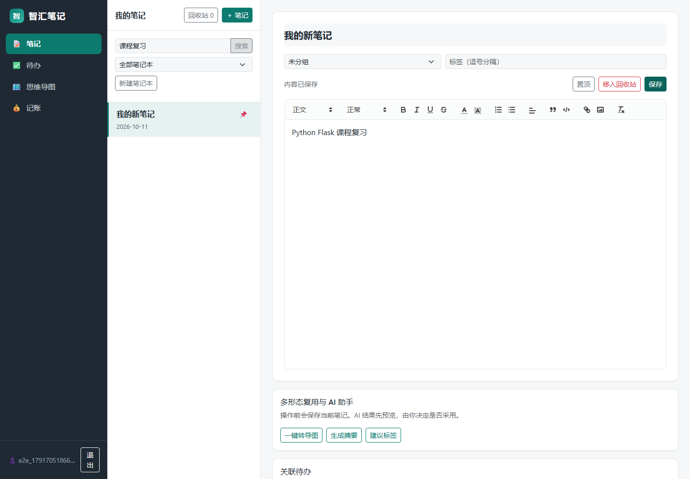
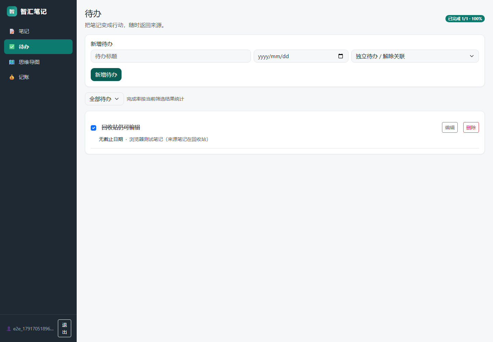
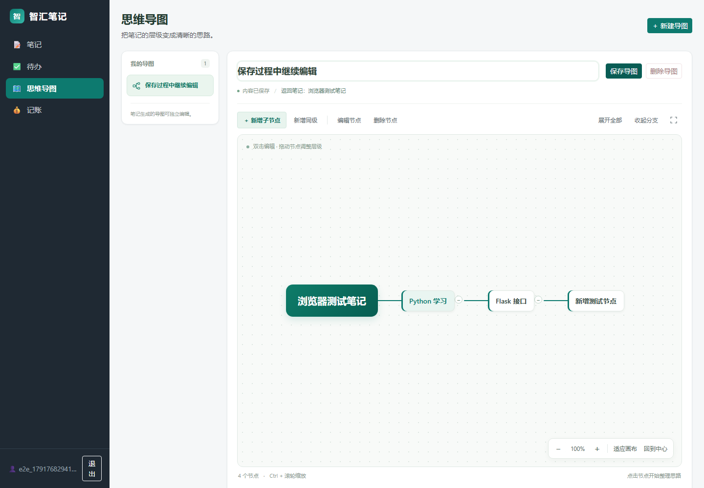
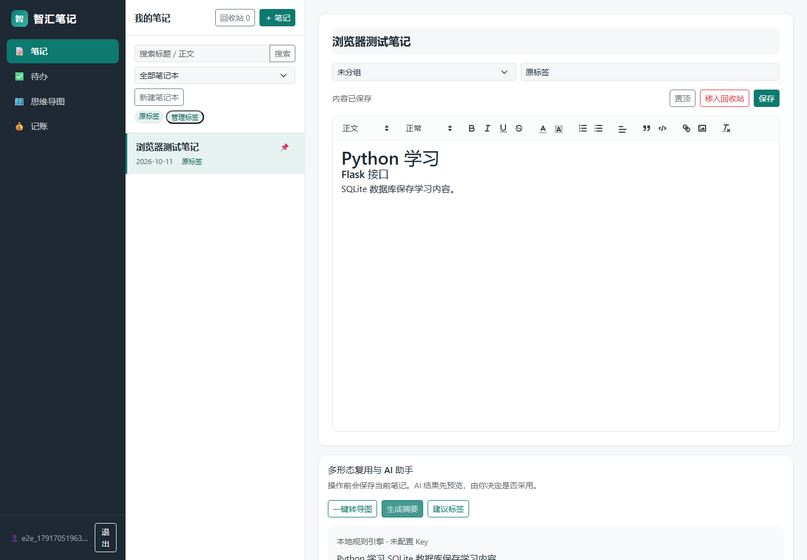
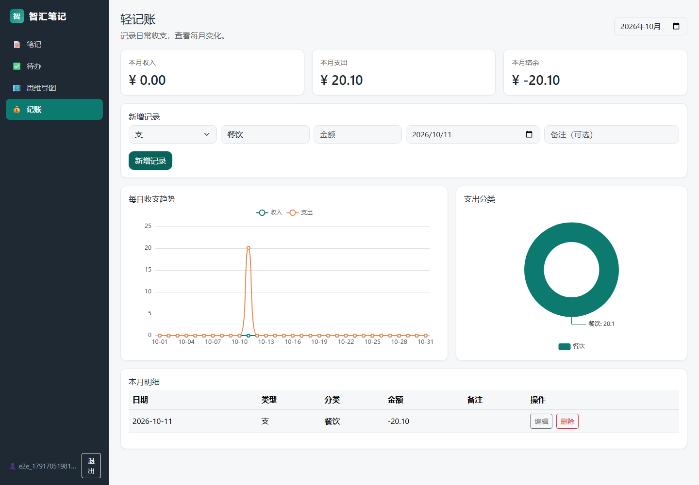
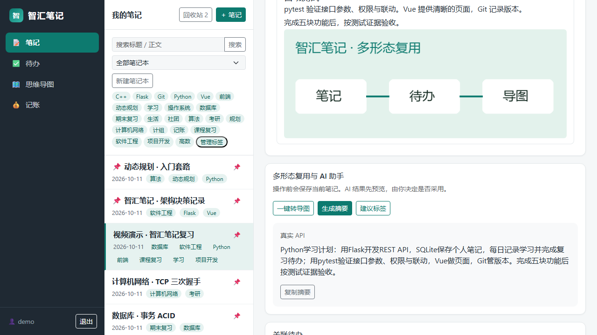
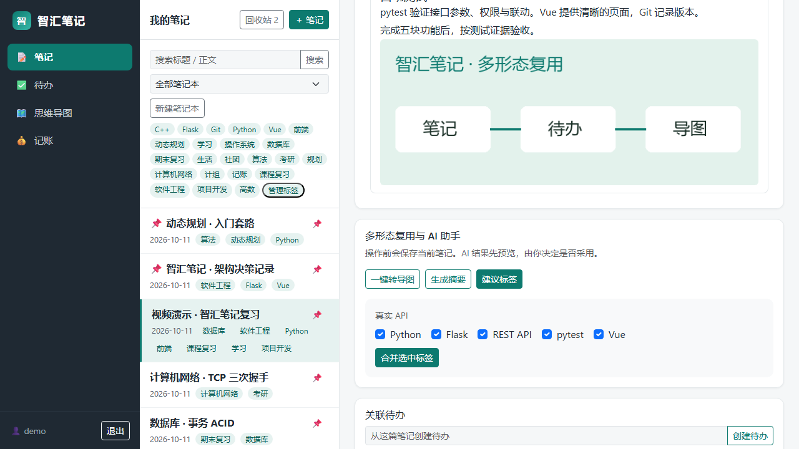

# 智汇笔记 测试报告

## 测试环境与结果

2026年10月11日，本机Windows x64，Python3.11.16、Node20.19.5、Chromium141。原37项测试作为基线通过；扩展后共106项后端测试通过，12条浏览器流程通过。Node20构建通过，npm依赖审计当前为0项漏洞。

| 验证 | 结果 | 证据 |
|---|---|---|
| pytest | 106通过，0失败 | evidence/backend-tests.xml |
| Playwright | 10月12日更新后14通过，0失败；各流程页面异常列表为空 | evidence/browser-tests.json |
| Node20构建 | 通过 | package-lock.json与构建产物 |
| 依赖审计 | 0项 | 最终运行日志 |
| 外网阻断 | 本地页面、数据和AI可用 | 浏览器断网流程 |

浏览器场景包括认证刷新、富文本和图片保存、未保存三种处理、待办关联与来源删除、导图生成编辑与预览覆盖、节点HTML按文字显示、AI预览采用、账目统计、外网阻断、快速切换和手机宽度。

## 关键异常覆盖

后端测试覆盖JSON类型错误、日期无效、跨用户ID、笔记来源删除、非法导图结构、重复节点ID、无标题及百节点、金额精度与跨月、空月份和闰年。AI使用模拟响应验证成功协议、超时、连接错误、HTTP错误、无效结果和硬等待预算；测试未读取真实Key或向外部AI发送正文。

## 修复与限制

基线附带环境指向原作者电脑，已重建；正文HTML与搜索副本统一由后端处理；清理时保留Quill排版类。前端Quill版本调整到2.0.2，修复依赖审计问题。浏览器流程使用实际页面与本地独立演示数据库。

2026年10月11日使用小组提供的Key完成真实DeepSeek调用：摘要1.27秒、标签1.47秒，均返回engine=api；模型deepseek-flash。记录见evidence/real-api-test.json，证据与交付包均不包含Key。人工测试表和最终演示电脑复验尚待成员执行。构建存在图表模块体积提示，不影响构建成功；本地演示不通过网络下载该模块。

## 页面证据

解压至全新D盘目录，使用25份本地wheel安装成功，106项后端测试再次通过，12条浏览器流程在解压后的独立服务再次通过。记录见evidence/offline-tests.xml、evidence/offline-browser-tests.json和evidence/offline-install.txt。

最终交付包补入便携Python 3.11.16后，再次在全新目录执行setup.ps1 -Offline；使用包内运行时与25份wheel安装成功，106项测试通过（27.84秒）。记录见evidence/offline-runtime-tests.xml和evidence/offline-runtime-install.txt。此安装路径无需系统预装Python或Node。

真实网页预览证据：

演示视频为600.05秒、1280×720、含中文合成旁白和章节字幕。实际操作录屏与说明画面结合，技术记录见evidence/video-verification.json。

## 2026年10月12日导图布局修复

针对首次显示时节点重叠、连线错位的问题，改用jsMind的wrap模式和稳定的节点固有宽度；样式在测量前生效，字体就绪后再次布局。SVG连线与节点采用分支配色，缩放后重新计算画布边距以保持居中；浮动视图按钮置于节点图层上方，避免被画布拦截。

新增两条浏览器回归：长标题与多层节点在首次打开、刷新、缩放和窄屏下不重叠、不截断；实际拖拽改变层级后保存，以及双击编辑、同级节点、收起展开和全屏操作。全部14条流程通过（20.0秒）。测试使用独立的.tools/mindmap-qa.db，不修改个人数据库或演示内容；另以演示账号只读检查现有导图，桌面、全屏和手机宽度均无页面异常。

Node20构建通过。当前界面证据见mindmap-demo-after.png、mindmap-fullscreen-after.png、mindmap-mobile-after.png、mindmap-layout.png和mindmap-interactions.png；mindmap-before.png保留修复前的重叠场景。旧版12条离线验证记录仍保留于offline-browser-tests.json。PPT与10分钟视频记录10月11日版本，导图更新后的界面以本节截图和当前网页为准。
